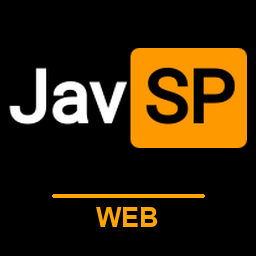

# JavSP WEB

在浏览器中刮削影片资料、整理媒体文件并管理媒体库。支持 Windows、Docker 和 NAS 部署。

> 本项目是**上游开源项目的衍生修改版本**，不是原作者的官方项目，也不代表原作者的观点或背书。
> 来源、署名与授权说明见下方 [来源与版权](#来源与版权)。

完整的安装、配置、刮削、AI、自动化、故障排查和接口说明，请看仓库内文档站：`docs/docs.html`（部署到 GitHub Pages 后为 `https://fyy656.github.io/JavSP-Web-Next/docs.html`）。

## 主要功能

- 识别番号，调用多个资料源获取标题、演员、剧情、封面和剧照。
- 处理单个视频、文件夹和批量任务，查看进度、日志与失败原因。
- 媒体库直接索引磁盘上的视频、NFO 与图片：多库多文件夹、后台扫描、多段视频合并、按番号/标题/女优/路径搜索、按女优/片商/年份分类浏览、隐私模式模糊封面、定位文件、库内单个或**批量刮削**、失败任务一键重试。
- 在个人中心选择头像，用用户名和 6 位 PIN 创建匿名评论身份；可跨设备查看自己的评论，支持点赞和安全验证。
- 使用刮削预设管理扫描、命名、NFO、图片和翻译设置；每部影片只维护一个 NFO，Emby / Jellyfin 读取的是同一份资料。
- 定时扫描目录，连接 qBittorrent，并在下载完成后自动刮削。
- 连接 Emby / Jellyfin，整理完成后刷新媒体库。
- 支持 AI 刮削、AI 翻译、上下文自动压缩和模型列表获取。
- 支持 CookieCloud、代理、路径映射、封面重试与任务文件还原。

## 快速开始

### Windows

1. 从 [Releases](https://github.com/fyy656/JavSP-Web-Next/releases/latest) 下载 `JavSP-Web.exe`。
2. 双击运行，浏览器打开 `http://127.0.0.1:8090/login`。
3. 首次使用账号和密码均为 `admin`，登录后立即在“系统设置 → 用户管理”修改密码。

配置和任务记录默认保存在程序旁的 `data` 文件夹。升级时保留该文件夹即可。

#### 局域网访问

默认只允许本机访问（`127.0.0.1`）。需要手机、平板或局域网内其他电脑访问时：

1. 登录后进入“系统设置 → 网络访问”，勾选“允许局域网访问”并保存（Windows 会自动尝试添加防火墙规则，需要管理员权限；失败时按提示手动执行命令）。
2. 重启程序，设置面板会显示形如 `http://192.168.x.x:8090` 的地址，同一网络下的设备用该地址登录即可。

HTTP 为明文传输，请仅在可信的家庭网络中使用；从公网访问务必使用下文“通过反向代理提供 HTTPS”中的配置。Docker 部署本身已可通过 `http://服务器地址:8090` 访问，监听地址由 `JAVSP_WEB_HOST` 决定，“网络访问”开关只影响防火墙规则。

### Docker Compose

安装 Docker 和 Compose，在空目录创建 `docker-compose.yml`：

```yaml
services:
  javsp-web:
    image: ghcr.io/fyy656/javsp-web-next:latest
    container_name: javsp-web
    restart: unless-stopped
    ports:
      - "8090:8090"
    environment:
      JAVSP_WEB_HOST: 0.0.0.0
      JAVSP_WEB_PORT: 8090
      JAVSP_WEB_TIMEZONE: Asia/Shanghai
      TZ: Asia/Shanghai
    extra_hosts:
      - "host.docker.internal:host-gateway"
    volumes:
      - ./data:/app/data
      - /你的影片目录:/media
```

启动后浏览器打开 `http://服务器地址:8090/login`。`/app/data` 保存配置与任务记录，请务必挂载到宿主机；影片目录按实际路径挂载，多个目录可继续追加 `volumes`。

## 来源与版权

### 上游项目

- **JavSP**（刮削核心）：<https://github.com/Yuukiy/JavSP>
  - 版权归原作者 **Yuukiy** 及 JavSP 贡献者所有。
- **JavSP-Web**（网页端）：<https://github.com/APecme/JavSP-Web>
  - 版权归原作者 **APecme** 及 JavSP-Web 贡献者所有。

本项目（`JavSP-Web-Next`）在上述项目基础上做了修改与二次开发，包括媒体库索引与批量刮削、失败重试、分类浏览、NFO 统一、性能优化，以及界面、交互与文档的调整。上游代码与资源按原有许可证分发，**原始著作权、许可证与署名均予以保留**，未声明为原作者官方版本。

### 许可证

本项目及其衍生的上游代码遵循 **GNU General Public License v3.0**：仓库根目录 `LICENSE` 为完整许可证文本，上游刮削核心的许可证见 `vendor/JavSP/LICENSE`，第三方组件的许可证见 `THIRD-PARTY-NOTICES.md`。

### 免责声明

- 本项目与上游项目、任何影片站点、媒体服务器厂商均无隶属或合作关系；相关名称与商标归各自所有者。
- 本项目仅供个人学习与技术研究使用。使用者应自行确认所处理内容的合法性，并对自己使用本软件的行为负责。
- 软件按“现状”提供，不附带任何明示或暗示的担保；因使用本软件造成的任何损失由使用者自行承担。
- 请勿将本软件用于侵犯版权、传播违法内容或其他违反当地法律法规的用途。

## 参与开发

- 反馈与建议请通过本仓库的 Issues 提交；提交日志、截图或配置时请**自行脱敏**（去掉本地路径、域名、账号、番号等隐私信息）。
- 提交代码前请运行仓库内置测试：

```bash
python -m unittest discover -s tests -p "test_*.py"
node tests/test_web_client.cjs
```

## 目录结构

```
javsp_web/           Web 服务与前端资源
  web/               前端页面与静态资源
  library_store.py   媒体库索引（以磁盘为准）
  tasks.py           任务调度与引擎调用
vendor/JavSP/        上游刮削核心（保留原许可证）
docs/                文档站点（GitHub Pages）与发布说明
scripts/             构建、演示站点与维护脚本
tests/               单元测试与前端回归测试
```
